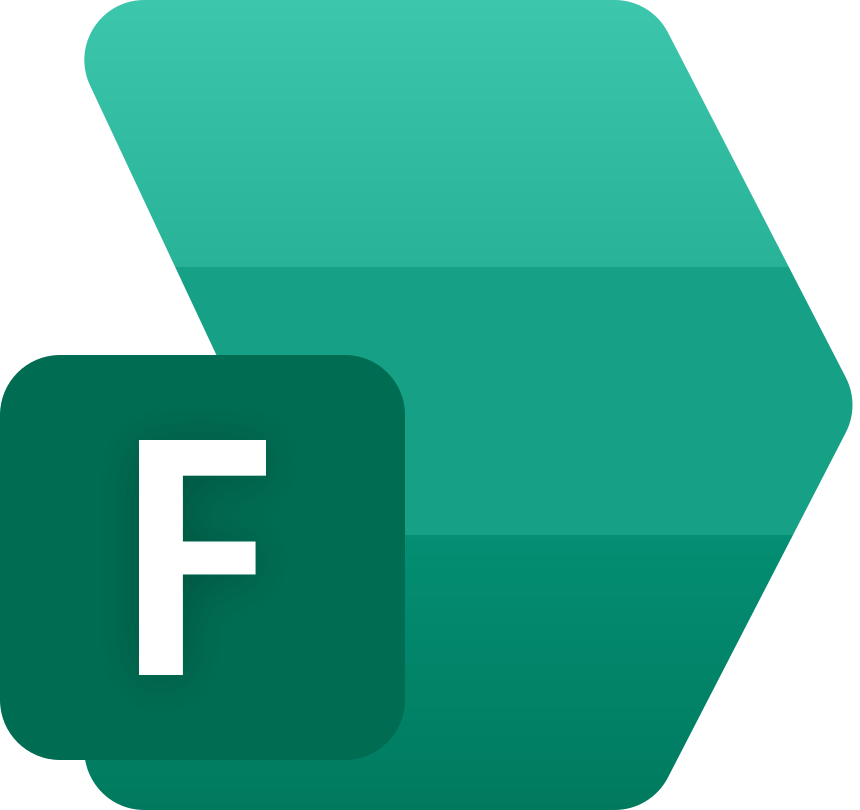

<div align="center">



# Triflare Fx

Code PenguinMod projects with text.

</div>

## Table of Contents

<!-- START doctoc generated TOC please keep comment here to allow auto update -->
<!-- DON'T EDIT THIS SECTION, INSTEAD RE-RUN doctoc TO UPDATE -->

- [Highlights](#highlights)
- [Overview](#overview)
- [Usage](#usage)
- [Vendoring Extensions](#vendoring-extensions)
- [Installation](#installation)
- [Feedback and Contributing](#feedback-and-contributing)

<!-- END doctoc generated TOC please keep comment here to allow auto update -->

## Highlights

- **Build PenguinMod projects with text:** Instead of dragging blocks into a canvas, you code PenguinMod projects using the keyboard with a domain-specific language inspired by JavaScript.
- **Integrates with VS Code:** Though you must [build and install the extension yourself](./editors/vscode/), Triflare Fx has a VS Code extension for syntax highlighting and language features.
- **Compile and decompile:** Compile Triflare Fx projects into .pmp, and back again. This also works for PenguinMod projects that were not compiled with Triflare Fx.
- **Feature parity:** Most features in PenguinMod also exist here. If you're coming fresh from PenguinMod to Triflare Fx, after learning the syntax, it's basically the same thing.

## Overview

If you want a PenguinMod project that works in git, or you want a better way to format, lint, and manage less UI-driven projects (like TUI OSes), there isn't exactly a solution for you... besides Triflare Fx.

Triflare Fx is a domain-specific language that allows you to code PenguinMod projects with text code, and decompile existing projects. It works best in those use-cases.

## Usage

```bash
$ fx init

  • fx.yml
  • src/main.tfx
  • assets/cat.svg

$ fx build

✓ Built build/my-triflare-fx-project.pmp
  sources:    1 file(s)
  targets:    2
  blocks:     8
  assets:     2
  extensions: (none)
```

## Vendoring Extensions

Extension URLs are mutable and can disappear, so Fx can commit a verified copy of every extension instead. Declare them under `vendor:` in `fx.yml`; order is load order:

```yaml
vendorDir: extensions # default
vendor:
  signals: https://example.com/signals.js
  xterm:
    url: http://localhost:8080/xterm.js
    volatile: true
  mything: ./src/mything.js
```

`fx vendor install <url|path> --as <name>` copies the source to `extensions/`, records its SHA-256 in `fx.lock`, and adds it to `fx.yml`. Builds load the vendored copy and embed its source, so no network access is needed after installation. Remote entries fail if their hash changes; `volatile` entries (such as localhost URLs) warn instead. Local paths remain the source of truth and are re-copied on each build with a generated-file header.

`vendorDir` must be a directory inside the project directory.

```bash
fx vendor install              # restore from fx.lock, fetching only missing files
fx vendor update [name]        # show a diff and write updated files and fx.lock
fx vendor update [name] --dry-run # preview changes without writing
fx vendor outdated             # compare upstream with fx.lock
fx vendor verify               # check files against fx.lock, offline
fx vendor remove <name>
fx vendor list [--json]
fx vendor migrate              # move project.extensions under vendor:
```

`fx vendor migrate` writes `fx.yml.bak` first and shows the config diff. Builds only offer migration when running in a terminal; use `--no-upgrade-prompt` or `FX_NO_PROMPT=1` to keep the legacy `project.extensions` behavior.

## Installation

**Requirements:**

- At least Node.js v24.

Packaging downloads the PenguinMod runtime and, for desktop targets, an Electron or NW.js runtime on first use. Those downloads are cached locally.

To use `fx` raw instead of `npx @triflare/fx`, install Triflare Fx globally:

```bash
npm i -g @triflare/fx
```

## Feedback and Contributing

If you've found a bug, or you want a new feature, please [open an issue](https://github.com/triflare/fx/issues). If you'd rather implement it yourself, make your changes and [open a pull request](https://github.com/triflare/fx/pulls).

Thank you for improving Triflare Fx! It's people like you who make open-source projects like these thrive.
